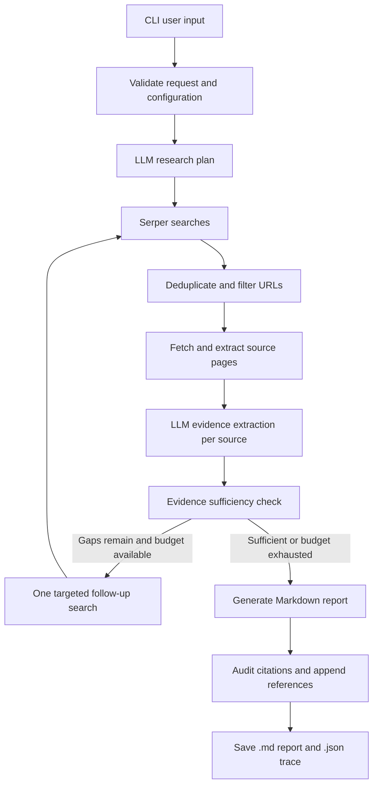

# ResearchPilot — Autonomous Research Agent

ResearchPilot is a CLI-first web research agent. It plans an investigation with an LLM, searches with Serper, attempts to read the selected source pages, extracts source-grounded evidence, performs one bounded follow-up search when meaningful gaps remain, and writes a Markdown report plus a JSON trace.

> **Evidence note:** the report distinguishes full-page text from search-snippet-only evidence. It does not guarantee that sources are correct; use the citations to verify important claims.

## Features

- User-provided research questions (interactive CLI or command-line flags).
- Research modes: `academic`, `competitive`, `content`, and `general`.
- LangGraph workflow with a bounded follow-up search round.
- Serper search API and GPT-4o through LangChain's `ChatOpenAI` integration.
- Concurrent, bounded search and page retrieval.
- Page text extraction through Trafilatura, with BeautifulSoup fallback.
- Domain include/exclude filters, URL de-duplication, timeouts, redirect limits, and basic SSRF protections.
- Citation ID audit, source inventory, Markdown report, and JSON research trace.
- Pytest unit/integration-with-fakes tests that require no live API keys.

## Architecture



### Modules

| File | Responsibility |
|---|---|
| `research_agent/cli.py` | CLI arguments, interactive input, setup, lifecycle and user-facing output. |
| `research_agent/config.py` | Loads `.env` settings and checks required credentials. |
| `research_agent/schemas.py` | Pydantic contracts for requests, plans, sources, evidence and sufficiency. |
| `research_agent/search.py` | Serper HTTP client, response validation and bounded retries. |
| `research_agent/fetcher.py` | URL safety checks, bounded HTML retrieval, metadata and main-text extraction. |
| `research_agent/prompts.py` | Prompts for planning, evidence extraction, sufficiency and report writing. |
| `research_agent/graph.py` | LangGraph nodes, conditional route, concurrent steps and output trace. |
| `research_agent/report.py` | Citation auditing and deterministic Markdown References section. |
| `tests/` | Mocked tests for schemas, Serper, page extraction, report assembly and end-to-end workflow. |

## Requirements

- Python 3.11 or newer; use a current supported CPython release.
- OpenAI API access for `gpt-4o`.
- Serper API access for web search.
- Internet access from the machine running the agent.

API usage may incur costs. The default model is `gpt-4o`; set `OPENAI_MODEL` only if you intentionally want another supported model.

## Installation

### Windows PowerShell

```powershell
py -3.11 -m venv .venv
.\.venv\Scripts\Activate.ps1
python -m pip install --upgrade pip
pip install -r requirements.txt
Copy-Item .env.example .env
```

Open `.env` and fill in the keys:

```dotenv
OPENAI_API_KEY=your_openai_api_key
SERPER_API_KEY=your_serper_api_key
OPENAI_MODEL=gpt-4o
LOG_LEVEL=INFO
OUTPUT_DIR=output
```

Keep `.env` private. Do not commit it to GitHub or put API keys in source code.

If PowerShell prevents virtual-environment activation, use the virtual environment's interpreter directly instead:

```powershell
.\.venv\Scripts\python.exe -m pip install -r requirements.txt
.\.venv\Scripts\python.exe -m pytest -q
```

### macOS / Linux

```bash
python3 -m venv .venv
source .venv/bin/activate
python -m pip install --upgrade pip
pip install -r requirements.txt
cp .env.example .env
```

Then edit `.env` with your API keys.

## Run ResearchPilot

Run from the repository root.

### Competitive intelligence

```bash
python -m research_agent.cli --query "Compare LangGraph and CrewAI for production AI agents" --mode competitive --depth deep --max-sources 8
```

### Academic / technical research

```bash
python -m research_agent.cli --query "Recent approaches to evaluating retrieval-augmented generation systems" --mode academic --depth standard --max-sources 8 --recency-days 365
```

### Content research

```bash
python -m research_agent.cli --query "How do AI agents plan and use tools?" --mode content --language English --audience "Software engineering readers" --depth brief
```

### Restrict or exclude domains

```bash
python -m research_agent.cli --query "Python packaging best practices" --include-domain docs.python.org --include-domain packaging.python.org
python -m research_agent.cli --query "An industry overview" --exclude-domain example.com
```

Use `--help` to see all supported parameters. If `--query` is omitted, the CLI asks for a topic interactively.

Reports and traces are written to `output/` by default. Override with `--output-dir path/to/output` or set `OUTPUT_DIR` in `.env`.

## Output files

Each run creates a timestamped pair:

- `*.md`: research question, executive summary, analysis, limitations, conclusion and references.
- `*.json`: request, plan, search queries and metadata, retrieval status, evidence records, sufficiency check, citation audit and error messages.

Snippet-only sources are labeled as not fully verified. Source retrieval failures are retained in the trace so that partial results are not silently lost.

## Test

Tests mock OpenAI, Serper and page retrieval, so running tests should not incur API charges:

```bash
python -m pytest -q
```

The graph test uses fake LLM/search/page-reader dependencies to exercise the end-to-end pipeline deterministically. Passing tests verifies tested code paths only; it does not prove that real API credentials, billing, network access, or all external websites work.

## How the workflow works

1. **Request validation:** Pydantic validates the query, research mode, depth, maximum source count and domain filters.
2. **Planning:** GPT-4o produces a structured research plan with subquestions, search queries and report outline.
3. **Search:** independent Serper queries run concurrently with a fixed worker limit. Search errors are recorded instead of discarding all successful results.
4. **De-duplication:** URLs are normalized conservatively and duplicate URLs are removed. Include/exclude domain filters are applied before source reading.
5. **Page retrieval:** the page reader validates destinations, follows redirects manually with revalidation, caps redirects and content size, and extracts main text. Inaccessible pages can remain as snippet-only sources when a search snippet exists.
6. **Evidence extraction:** GPT-4o receives source content as untrusted material and returns a structured summary, claims, excerpts and limitations. Source IDs are attached by application code, not invented by the model.
7. **Sufficiency check:** the agent checks whether the evidence addresses the planned questions. It may run at most one targeted follow-up search round, subject to the source budget.
8. **Report generation:** the model synthesizes the collected evidence into a Markdown report and is instructed to cite provided source IDs.
9. **Citation audit:** the application removes unknown citation IDs, warns when the model omitted valid citations, and creates a References section from collected source metadata.
10. **Trace persistence:** report and JSON trace are saved for inspection and reproducibility.

## Limitations and safety notes

- The report is an AI-generated synthesis, not peer review or a guarantee of truth. Verify high-impact claims manually.
- Search result rankings are not equivalent to source quality.
- The recency option guides planning; it is not a guarantee that every result is within the requested time window.
- Some pages block automated retrieval, use JavaScript-only rendering, or provide only a snippet. The agent labels these cases rather than claiming it read them.
- URL validation blocks many local/private destinations and redirects are revalidated. No application-level URL check completely eliminates all DNS-rebinding or infrastructure-specific SSRF risks; run this tool with least privilege and keep dependencies updated.
- Citation checks verify source identifiers, not whether a cited source semantically proves every sentence. Manual evidence review remains important.
- This CLI does not bypass paywalls or access controls, execute retrieved content, or use a browser automation engine.

## Future improvements

1. Add a claim-level evaluation suite comparing report claims against source excerpts.
2. Add caching keyed by normalized URL and content hash.
3. Add observability with per-node timings and token/cost estimates.
4. Add a human review step before exporting or publishing a report.
5. Add optional domain-specific ranking and academic metadata connectors.
6. Add streaming progress output and a web UI only after the CLI pipeline is stable.

## Technical references

- [LangGraph documentation](https://docs.langchain.com/oss/python/langgraph/overview)
- [LangChain ChatOpenAI reference](https://reference.langchain.com/python/langchain-openai/langchain_openai/chat_models/base/ChatOpenAI)
- [Structured output reference](https://reference.langchain.com/python/langchain-openai/langchain_openai/chat_models/base/ChatOpenAI/with_structured_output)
- [Serper](https://serper.dev/)
- [Trafilatura documentation](https://trafilatura.readthedocs.io/)
